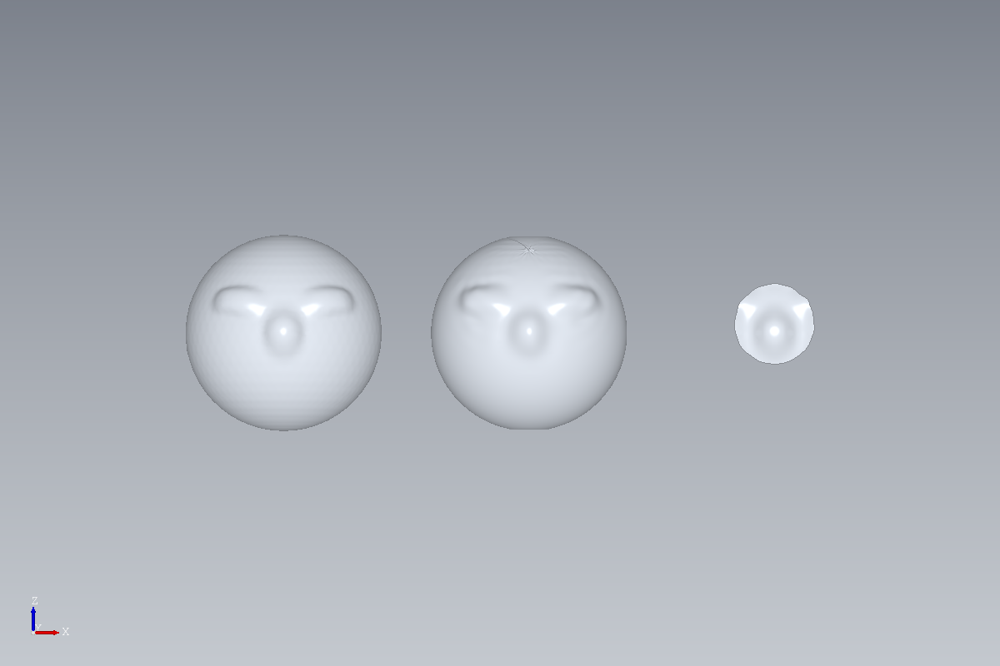

# Fitting smooth surfaces to meshes (PLAN item 16, part 2)

Scan to CAD: `FITSURF` turns a mesh body into smooth NURBS geometry. Until
now a mesh could only become a faceted solid (`TOSOLID`, one flat face per
triangle). Command reference: LANGUAGE.md section 29.

*Left: a sculpted mesh (14,000 points). Middle: `FITSURF, scan, ALL, 0.15`,
one smooth surface closed into a solid (40 x 40 control points, 0.16 mm at
most and 0.012 mm on average from the mesh), with a hole cut through it.
Right: `FITSURF, scan, MASK`, only the painted face region, as one trimmed
face.*

## How it works (geometry/meshfit.py)

Only numpy and the kernel; no new dependency.

**Open patches** (an open mesh, or the masked region):

1. The largest connected piece of the region is taken. Its best-fit plane
   (principal axes of its points) gives each point a position on the plane
   and a height above it.
2. The patch must be a height field over that plane: laid flat, no triangle
   may turn over (more than 0.2% of the area turning over is refused, with a
   note to fit it in smaller pieces).
3. The surface is a cubic B-spline whose control points sit on an even grid
   over the plane, so the plane directions are reproduced exactly and the
   surface can never fold. Only the heights are fitted, by least squares,
   with a small bending penalty so that control points with no data under
   them (outside a round outline) stay smooth.
4. The grid starts at 4 x 4 (shaped to the patch's proportions) and grows by
   half each time until every point is within the tolerance, up to 40 x 40,
   and never past a quarter of the number of points (past that it would
   follow the mesh's facets, not the shape).
5. The outline and any holes (the patch's border edges) are fitted as
   smooth closed curves in the surface's parameter space and trim it.

**Closed meshes**:

1. The body's volume centre must see every triangle from outside
   ("star-shaped"), otherwise it is refused.
2. Each point gets a longitude and latitude round the centre. The surface
   is round (periodic) in longitude, and its first and last rows of control
   points each gather to one point, like a globe. All control points are
   fitted together by least squares on x, y and z.
3. The gathering points look pinched where the shape has detail, so the
   axis is chosen among 12 directions where the radius varies least near
   both ends; the seam goes down the plainest side.
4. The face is closed into a shell and a solid, outside out.

The deviation is measured along the plane's normal for patches, and as the
true distance to the surface (on up to 4,000 sample points) for closed
fits.

## Measured

| Mesh | Result | Time |
| --- | --- | --- |
| wavy patch with a hole, 10,600 points, tol 0.05 | 9 x 7 control points, 0.037 max | 0.2 s |
| sphere r 20 as 4,000 triangles, default tol | solid, volume within 0.01% of the true sphere | 1 s |
| bumpy ellipsoid, 8,000 triangles, tol 0.05 | 32 x 16, 0.036 max, volume within 0.6% of the mesh | 2.6 s |
| the sculpted head, 14,000 points, tol 0.15 | 40 x 40, 0.16 max (warning), 0.012 average | 4 s |

## Left for later

- Shapes that are neither one height field nor star-shaped (a mug, a
  bracket scan) need splitting into regions by curvature and fitting each,
  then joining the pieces along shared edges. Today you paint each region
  with `MASK` and fit it as its own face.
- Recognising planes, cylinders and spheres in a scan and fitting them
  exactly.
- Sharp edges in a closed fit are rounded off by the smooth surface.
