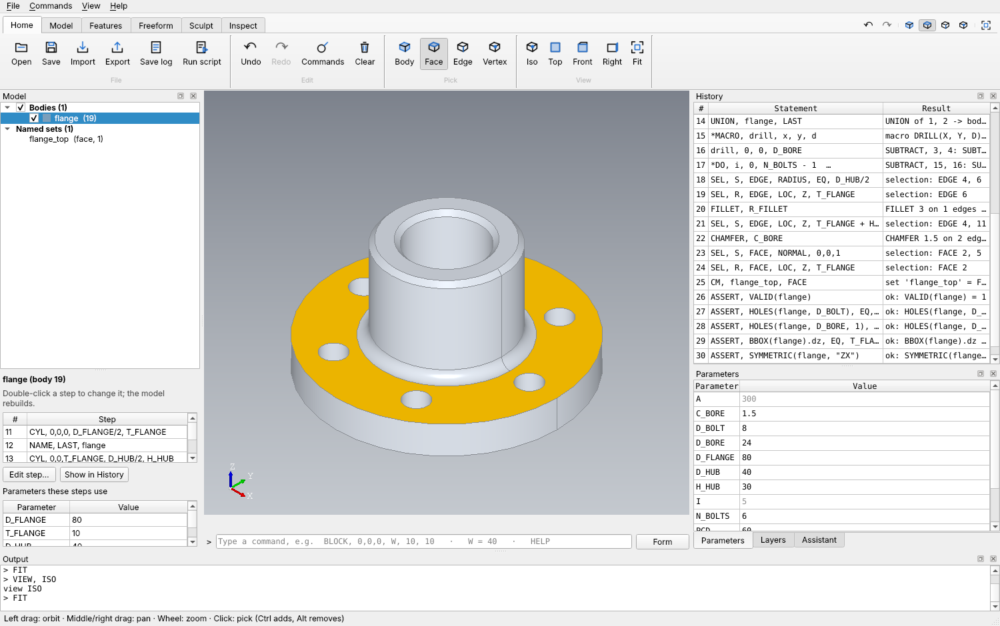

---
hide:
  - navigation
  - toc
---

<div class="m3d-hero" markdown>

# 3Dmodeling

A 3D modeler for solid parts where **every click is a command**. Build with the
mouse, and the app writes each step as a short line of text in the History.
Change any number later and the part rebuilds, or write the whole part as a
script.

[Quick start](quick-start.md){ .md-button .md-button--primary }
[Download](https://github.com/shashanksingh097/3Dmodeling/releases){ .md-button }
[All commands](reference/index.md){ .md-button }

</div>

{ .m3d-shot }

## Mouse or text: the same thing

Clicking **Block…** and pressing OK writes `BLOCK, 0,0,0, 80, 40, 8` in the
History. Typing that line does exactly the same. So everything you make is
also a script you can save, edit, share and run again.

=== "A script"

    ```text
    ! a bracket: plate, two holes, a rounded top edge
    W = 80
    T = 8
    BLOCK, 0,0,0, W, 40, T
    NAME, LAST, bracket
    HOLE, bracket, 15, 20, T, 8
    HOLE, bracket, W - 15, 20, T, 8
    SEL, S, EDGE, LOC, Z, T
    FILLET, 2
    ```

    Change `W` to 120 in the Parameters panel and the whole part rebuilds,
    holes and rounds included.

=== "The same with the mouse"

    1. **Block…** on the Model tab, size 80, 40, 8.
    2. Click the top face, then **Hole…** on the Features tab.
    3. Pick **Edge**, Ctrl+click the top edges, **Fillet…** with radius 2.

    Each step appears in the History as the line on the other tab.

## What you can make

<div class="grid cards" markdown>

-   { loading=lazy }

    **Solid parts**: blocks, cylinders, holes, fillets, shells, drafts,
    patterns. [Shapes](language/part-features-hole-split-shell-draft-offset.md)

-   { loading=lazy }

    **Sketches** held by constraints and sizes, extruded or revolved.
    [Sketches](app/sketches.md)

-   { loading=lazy }

    **Shapes on curves**: lofts, sweeps with twist and scale laws, pipes,
    rail sweeps. [Shapes on curves](language/shapes-on-curves.md)

-   { loading=lazy }

    **Freeform surfaces** from control points, networks, fills and blends.
    [NURBS](language/nurbs-freeform-control-points-networks-patches-and-sewing.md)

-   { loading=lazy }

    **Parts and assemblies**: reusable parts, real threads, standard
    fasteners, gears, mates, motion. [Parts](language/parts-and-instances.md)

-   { loading=lazy }

    **Sheet metal, frames, plastic parts and moulds**, with flat patterns
    and cut lists. [Sheet metal](language/sheet-metal.md)

-   { loading=lazy }

    **Meshes and sculpting**: fast mesh booleans, lattices, brushes, scan
    to CAD. [Meshes](language/mesh-bodies-big-triangle-meshes-fast-mesh-booleans-smoothing.md)

-   { loading=lazy }

    **Checks**: measuring, clashes, a first strength check, print checks,
    milling paths, drawings and pictures. [Checking](language/checking-and-describing-assert-describe-selfor-lint-diff-contact-clearance-relate-compare-designcheck.md)

</div>

## Where to go next

| If you want to | Read |
|---|---|
| install it and make a first part | [Quick start](quick-start.md) |
| learn the window, picking, history and sketches | [Using the app](app/index.md) |
| write scripts: parameters, loops, macros, stable picks | [The command language](language/index.md) |
| look up one command, with an example you can paste | [Command reference](reference/index.md) |
| open a finished model and see how it was made | [Examples](examples.md) |
| get help from the AI assistant inside the app | [The assistant](app/the-assistant-github-copilot.md) |
