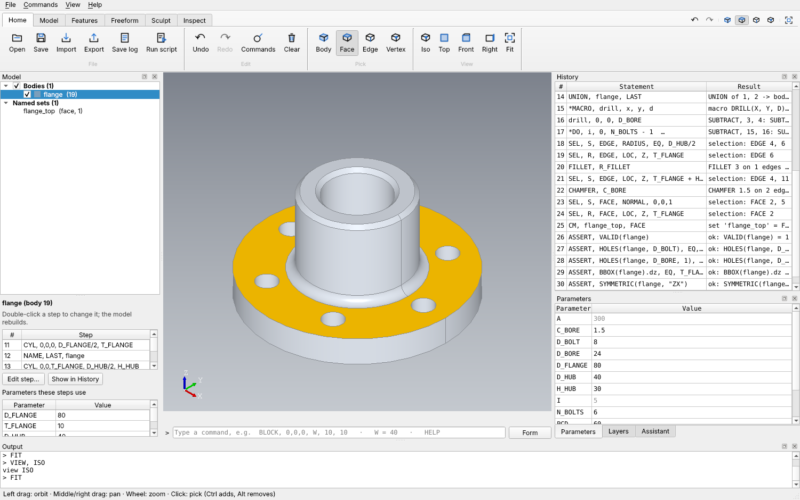
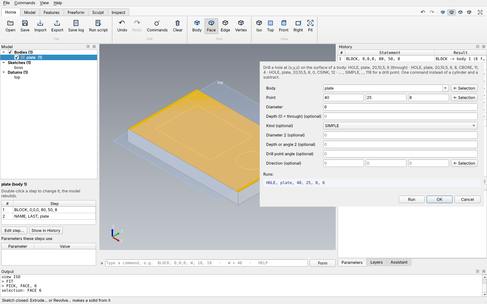
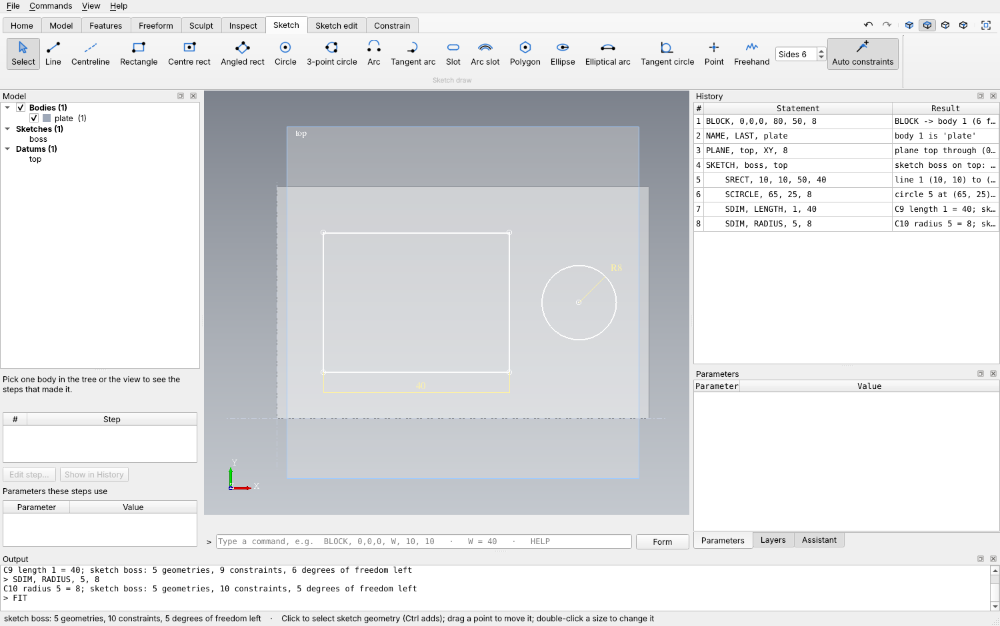
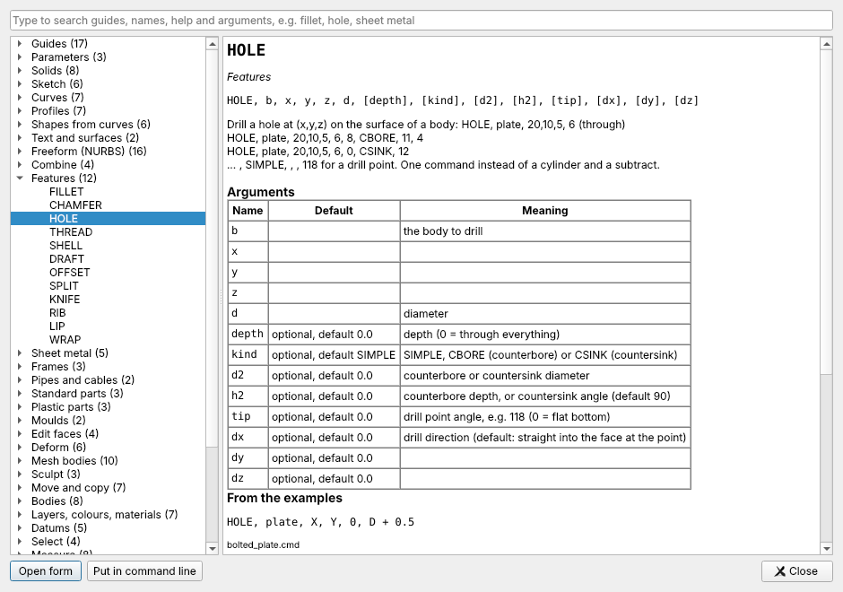

# Quick start

Ten minutes from download to a finished part, first with the mouse, then as
a script.

## 1. Install

Download the installer for your system from the
[Releases page](https://github.com/shashanksingh097/3Dmodeling/releases):
the `.msi` for Windows, the `.dmg` for macOS on Apple silicon, or the
`.tar.gz` for Linux. Or, with Python 3.10 or newer:

```bash
pip install git+https://github.com/shashanksingh097/3Dmodeling
modeler
```

More ways, and what to do about the first-start warning, are in
[Install](app/install.md).

## 2. The window

{ .m3d-shot }

* The **ribbon** at the top holds the buttons, in tabs: Home, Model,
  Features, Freeform, Sculpt and Inspect (and Sketch tabs while a sketch is
  open).
* The **3D view** in the middle: left drag turns it, middle or right drag
  moves it, the wheel zooms, **F** fits everything in view.
* The **command line** under the view: type any command and press Enter.
* The **History** on the right lists every step, as text. Double-click one to
  change it. **Parameters** (named numbers) are under it.
* The **Model** tree on the left lists bodies, sketches and datums; under it
  are the steps that made the picked body.

The full tour is in [The window](app/the-window.md).

## 3. A part with the mouse

1. **File > New** (Ctrl+N).
2. On the **Model** tab press **Block…**. Set the size to 80, 40, 8 and press
   **OK**.
3. Click the top face of the block. On the **Features** tab press
   **Hole…**: the form opens with the body and the point you clicked filled
   in. Give a diameter of 8 and press **OK**.

    { .m3d-shot }

4. Pick **Edge** (Home tab), Ctrl+click the top edges, then **Fillet…**
   with a radius of 2.

Look at the History: every step is a line of text, for example
`HOLE, 1, 40, 20, 8, 8`. Double-click the `BLOCK` line, change 80 to
120 and press OK. The hole and the rounds are made again on the longer
plate.

## 4. The same part as a script

Type these lines in the command line one by one, or save them in a file
`bracket.cmd` and use **File > Run script…**:

```text
W = 80                            ! a parameter: any number can use it
T = 8
BLOCK, 0,0,0, W, 40, T
NAME, LAST, bracket               ! a name instead of a number
HOLE, bracket, 15, 20, T, 8
HOLE, bracket, W - 15, 20, T, 8
SEL, S, EDGE, LOC, Z, T           ! every edge at height T: the top edges
FILLET, 2
```

Now change `W` in the Parameters panel. The part rebuilds. Selecting by
meaning (`SEL, S, EDGE, LOC, Z, T`) rather than by a clicked number keeps a
script right when sizes change.

## 5. A sketch

Sketches are flat drawings held by sizes and constraints:

```text
BLOCK, 0,0,0, 80, 50, 8
NAME, LAST, plate
PLANE, top, XY, 8                 ! a datum plane on the top face
SKETCH, boss, top
SRECT, 10, 10, 50, 40
SCIRCLE, 65, 25, 8
SDIM, LENGTH, 1, 40               ! line 1 is 40 long
ENDSKETCH
EXTRUDE, boss, 6, ADD, plate      ! push the profiles up 6, added to the plate
```

{ .m3d-shot }

With the mouse: pick a flat face, press **Sketch**, draw with the Sketch
tab, size things with the Constrain tab, then press **Extrude…**. See
[Sketches](app/sketches.md).

## 6. Finding a command

* **Commands** menu: a fill-in form for every command, by group.
* Ctrl+K: type a few letters of what you want ("fillet", "thread") and pick.
* Type a command name and press **F2** for its form, or **Ctrl+F1** for its
  help page.
* **Help > Command reference**: every command with its arguments and
  examples, searchable.

{ .m3d-shot }

The same reference, with a tested example for every command, is on this
site: [Command reference](reference/index.md).

## Next

* [Changing a part later](app/changing-a-part-later.md): edit, insert,
  suppress and roll back steps.
* [The command language](language/index.md): loops, conditions, macros and
  stable references.
* [Examples](examples.md): finished models to open from **File > Open
  example**.
